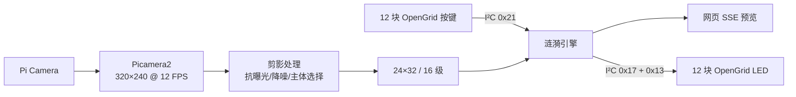

# Mirror — 12 块 OpenGrid 组成的 24×32 交互光影镜

本项目把树莓派摄像头中距离最近的人或物体抽象成 24×32 剪影，并通过一组 I²C 总线实时显示到 12 块已烧录官方固件的 FREEPOET OpenGrid 板。按下任意板上按键时，该点会产生渐亮、渐暗的阻尼多环涟漪，同时扰动摄像头剪影的局部亮度。

> 本仓库只包含树莓派端程序。OpenGrid 板保持原厂固件，不需要重刷板端代码。协议与寄存器依据 [FreepoetOfficial/Open-Grid-Controller](https://github.com/FreepoetOfficial/Open-Grid-Controller)。

## 已实现

- Raspberry Pi Camera 实时采集，320×240 / 12 FPS。
- 前景抽取、最近主体选择、固体轮廓、抗曝光抖动和自适应降噪。
- 24×32 输出，剪影外严格为 0，剪影内生成 0–15 级实际硬件亮度。
- 每块 8×8 独立方向和地址映射；当前实机标定已写入示例配置。
- 官方 I²C 协议 `0x02`，单总线驱动 12 块板，并读取板上按键。
- 按键涟漪可在暗背景发光，并使原剪影随波峰/波谷起伏。
- 浏览器实时模拟器，显示的是已合成涟漪后、即将发往实体板的同一帧。
- systemd 开机自启；75°C 自动暂停，65°C 自动恢复。

## 系统一览



## 快速安装

硬件接线和供电确认无误后，在 Raspberry Pi OS 中执行：

```bash
git clone https://github.com/FreepoetOfficial/Mirror-huge-grid-made-by-OpenGrid.git
cd Mirror-huge-grid-made-by-OpenGrid
chmod +x install_on_pi.sh
sudo ./install_on_pi.sh "$USER"
sudo reboot
```

重启后：

```bash
i2cdetect -y 1
systemctl status opengrid-shadow --no-pager
systemctl status opengrid-thermal-guard --no-pager
```

首次安装时 `hardware.enabled` 默认为 `false`，以免接线未检查时误操作。确认 `i2cdetect` 可见 `0x24`–`0x2F` 后：

```bash
nano ~/opengrid-shadow/config.json
# 将 hardware.enabled 改为 true
sudo systemctl restart opengrid-shadow
```

在同一局域网的电脑或手机访问 `http://<树莓派IP>:8080/`。不要用电脑的 `127.0.0.1`，它指向电脑自己，不是树莓派。

## 当前实机布局

屏幕正面观看，左上角为板面地址位 `1000`，右下角为 `0011`：

| 行 | 左列 | 中列 | 右列 |
|---:|---|---|---|
| 1 | `1000` / 实测 `0x27` | `0100` / `0x2B` | `0000` / `0x2F` |
| 2 | `1001` / `0x26` | `0101` / `0x2A` | `0001` / `0x2E` |
| 3 | `1010` / `0x25` | `0110` / `0x29` | `0010` / `0x2D` |
| 4 | `1011` / `0x24` | `0111` / `0x28` | `0011` / `0x2C` |

当前 12 块的显示内容都需要逆时针旋转 90°。代码中旋转值以顺时针为正，因此 `board_rotations` 填 `270`。这是现场标定结果，不能根据地址位文字自行推断。

## 文档导航

- [硬件接线、供电、I²C 地址和板块布局](docs/HARDWARE.md)
- [Raspberry Pi OS、Wi-Fi、SSH、摄像头和软件环境从零建立](docs/SOFTWARE_SETUP.md)
- [图像处理、OpenGrid 协议、涟漪与网页的实现路径](docs/ARCHITECTURE.md)
- [背景、剪影、亮度、板块顺序和方向标定](docs/CALIBRATION.md)
- [日常运行、日志、温控、安全关机和备份恢复](docs/OPERATIONS.md)
- [灯板不亮、缺板、错位、网页连不上、噪点与残影排查](docs/TROUBLESHOOTING.md)
- [配置字段完整说明](docs/CONFIGURATION.md)
- [自动测试与实机验收表](docs/TESTING.md)

## 电脑上先运行模拟器

没有树莓派和灯板时也可验证处理链路：

```bash
python3 -m venv .venv
source .venv/bin/activate
python -m pip install -r requirements.txt
python app.py --synthetic
```

打开 `http://127.0.0.1:8080/`。页面必须通过 HTTP 访问；直接双击 `static/index.html` 会因为没有后端 API 而一直显示“连接中”。

## 验证

```bash
python -m unittest discover -s tests -v
python -m compileall -q app.py thermal_guard.py shadow tests
```

本项目已在 Raspberry Pi 4B 1 GB、12 块官方 OpenGrid 板和一组 400 kHz I²C 总线上完成实机验证。

官方协议交叉核对来源：[Open-Grid-Controller](https://github.com/FreepoetOfficial/Open-Grid-Controller) 与 [FREEPOET Keypad](https://github.com/FreepoetOfficial/FREEPOET_Keypad)。

## 安全提示

- 严禁用树莓派 5V 针脚给 12 块灯板集中供电。
- OpenGrid 外部 5V 电源的 GND 必须与树莓派 GND 共地。
- SDA/SCL 只能上拉到 3.3V，不得上拉到 5V。
- 先断电再插拔 CSI 排线、I²C 线和板块地址跳线。
- 展览现场建议使用有保险丝、有余量的 5V 电源和实体散热片/风扇；软件温控是最后一道保护，不能替代散热。

## License

[MIT](LICENSE) © FreepoetOfficial
