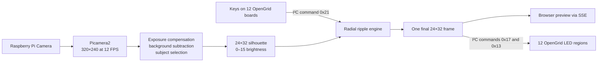

# Mirror — A 24×32 Interactive Light Wall Made from 12 OpenGrid Boards

## Demo video

[](https://youtube.com/shorts/S3AoeYm2MAg?si=n04Qq9E_cPv2Y_jr)

**[Watch the YouTube Shorts demonstration](https://youtube.com/shorts/S3AoeYm2MAg?si=n04Qq9E_cPv2Y_jr).** It shows the installation's simplest camera-to-light mapping behavior before the additional brightness, smoothing, residual-removal, and key-ripple effects described below.

This project turns the closest visible person or object in a Raspberry Pi camera image into a live 24×32 light silhouette. The image is displayed on twelve official FREEPOET OpenGrid boards arranged as a 3-column × 4-row wall. Pressing any key produces a damped, multi-ring ripple centered on that LED; the ripple remains visible on a dark background and also bends the brightness of the live camera silhouette without interrupting camera tracking.

The repository contains the complete Raspberry Pi application, browser simulator, OpenGrid I²C driver, key/ripple interaction, thermal protection, automatic startup configuration, tests, and installation documentation.

> **No custom controller firmware is required.** The OpenGrid boards keep their official firmware. The Raspberry Pi drives all twelve boards directly over one shared I²C bus. There is no RP2040 intermediary, USB controller, serial bridge, or UART link in this design.

The implementation follows the official [Open-Grid-Controller](https://github.com/FreepoetOfficial/Open-Grid-Controller) and [FREEPOET Keypad](https://github.com/FreepoetOfficial/FREEPOET_Keypad) protocol definitions.

## What the installation does

- Captures Raspberry Pi Camera video at 320×240 and 12 FPS.
- Compensates for camera exposure gain and global brightness changes.
- Learns an empty-scene background and extracts the most likely nearest foreground subject.
- Rejects small disconnected noise and fills holes inside the selected silhouette.
- Converts the result into a 24×32 matrix matching the physical wall.
- Keeps every non-silhouette pixel strictly off.
- Produces multiple real hardware brightness levels from 0 to 15, with dim edges and a brighter interior.
- Applies independent fade-in and fade-out timing for smooth movement.
- Detects long-lived stationary residuals using motion, component overlap, and background rebasing.
- Sends the final frame directly to twelve official OpenGrid boards over I²C.
- Reads keys from those same boards and generates physical radial ripples.
- Publishes the exact final 24×32 frame to a live browser preview for comparison with the real wall.
- Starts automatically after boot.
- Stops the main application at 75°C and restarts it after cooling to 65°C.

## Physical display geometry and exact board addresses

Each physical board contributes one 8×8 region. Twelve regions arranged as 3 columns × 4 rows create a 24-pixel-wide × 32-pixel-high display.

The table below is the **final measured installation mapping**. Positions are described while standing in front of the LED surface. The four-bit value is the hardware address marking used to identify the physical board in this installation; the hexadecimal value is the actual I²C address used by the Raspberry Pi software.

| Physical row | Left column | Center column | Right column |
|---:|---|---|---|
| Top / row 0 | board `1000` → **`0x27`** | board `0100` → **`0x2B`** | board `0000` → **`0x2F`** |
| Row 1 | board `1001` → **`0x26`** | board `0101` → **`0x2A`** | board `0001` → **`0x2E`** |
| Row 2 | board `1010` → **`0x25`** | board `0110` → **`0x29`** | board `0010` → **`0x2D`** |
| Bottom / row 3 | board `1011` → **`0x24`** | board `0111` → **`0x28`** | board `0011` → **`0x2C`** |

Visual layout:

```text
FRONT VIEW

global (0,0) / top-left                              global (23,0)
┌────────────────────┬────────────────────┬────────────────────┐
│ 1000               │ 0100               │ 0000               │
│ I²C 0x27           │ I²C 0x2B           │ I²C 0x2F           │
│ x 0–7, y 0–7       │ x 8–15, y 0–7      │ x 16–23, y 0–7     │
├────────────────────┼────────────────────┼────────────────────┤
│ 1001               │ 0101               │ 0001               │
│ I²C 0x26           │ I²C 0x2A           │ I²C 0x2E           │
│ x 0–7, y 8–15      │ x 8–15, y 8–15     │ x 16–23, y 8–15    │
├────────────────────┼────────────────────┼────────────────────┤
│ 1010               │ 0110               │ 0010               │
│ I²C 0x25           │ I²C 0x29           │ I²C 0x2D           │
│ x 0–7, y 16–23     │ x 8–15, y 16–23    │ x 16–23, y 16–23   │
├────────────────────┼────────────────────┼────────────────────┤
│ 1011               │ 0111               │ 0011               │
│ I²C 0x24           │ I²C 0x28           │ I²C 0x2C           │
│ x 0–7, y 24–31     │ x 8–15, y 24–31    │ x 16–23, y 24–31   │
└────────────────────┴────────────────────┴────────────────────┘
global (0,31) / bottom-left                         global (23,31)
```

Every board in the current mechanical assembly needs its local 8×8 image rotated **90° counter-clockwise**. Configuration rotations are expressed clockwise, so all twelve entries are `270`.

The installed configuration is therefore:

```json
"layout": [
  ["0x27", "0x2B", "0x2F"],
  ["0x26", "0x2A", "0x2E"],
  ["0x25", "0x29", "0x2D"],
  ["0x24", "0x28", "0x2C"]
],
"board_rotations": [
  [270, 270, 270],
  [270, 270, 270],
  [270, 270, 270],
  [270, 270, 270]
]
```

This mapping was established by comparing the browser matrix with the physical boards one by one. Do not recalculate it from the printed bit labels: the software must use the measured hexadecimal addresses above.

## System architecture



The webpage and the wall are fed from the same post-ripple frame. The browser is therefore a useful reference for board order, orientation, key position, and brightness behavior; it is not a separate cosmetic animation.

## Required hardware

- Raspberry Pi 4B, including the 1 GB model used for this installation.
- Raspberry Pi Camera and the correct CSI ribbon cable.
- Twelve official FREEPOET OpenGrid boards with official firmware.
- A stable Raspberry Pi power supply.
- A separate regulated 5 V supply sized for the peak LED load.
- Appropriate distribution wiring and fusing for the LED supply.
- SDA, SCL, and common-ground wiring.
- Strongly recommended: heatsink and fan for the Raspberry Pi.

## Camera connection

1. Shut down the Raspberry Pi and disconnect power.
2. Open the CSI connector latch.
3. Insert the camera ribbon in the correct orientation for the Pi and camera model.
4. Make sure both sides are inserted evenly, then close the latch.
5. Reconnect power only after the cable is secure.

Never connect or disconnect the CSI ribbon while powered. After booting, verify detection with:

```bash
rpicam-hello --list-cameras
```

Older Raspberry Pi OS images may use `libcamera-hello --list-cameras` instead.

## I²C wiring

All twelve boards share one parallel I²C bus:

| Raspberry Pi physical pin | BCM function | Connection |
|---:|---|---|
| Pin 3 | GPIO2 / SDA1 | SDA on every OpenGrid board |
| Pin 5 | GPIO3 / SCL1 | SCL on every OpenGrid board |
| Pin 6 or another GND | Ground | Every board ground and external supply negative |

Important electrical rules:

- Pull SDA and SCL up to **3.3 V only**. Never pull either signal to 5 V.
- Use one effective pair of bus pull-ups; 4.7 kΩ on SDA and 4.7 kΩ on SCL is a common starting point.
- If every board includes pull-ups, twelve parallel sets may create an excessively low effective resistance. Check the board schematic and disable unnecessary pull-ups if required.
- Keep SDA/SCL short, route them with a ground reference, and avoid running them beside high-current LED supply wiring.
- The production configuration uses 400 kHz I²C. If a long bus is unstable, test at 100 kHz and improve the wiring before increasing speed.

## Power distribution

**Do not power twelve LED boards from the Raspberry Pi 5 V header.** Use an independent regulated 5 V supply for the OpenGrid boards.

```text
Raspberry Pi PSU ───── Raspberry Pi
                          │ SDA
                          │ SCL
                          └ GND ─────────────────┐
                                                │ common ground
External 5 V PSU ─ fuse/distribution ─ OpenGrid boards
       negative ────────────────────────────────┘
```

- The Pi and LED boards may use separate supplies, but their grounds must be connected.
- Use star or grouped power distribution rather than passing the entire wall current through one small connector.
- Measure 5 V at the farthest board while many LEDs are bright; voltage drop can compress visible brightness levels or cause communication faults.
- Size the supply, wire gauge, connectors, and fuse from official board specifications and measured peak current, with safety margin.
- Check polarity before power-up and disconnect power before changing address links or signal wiring.

## Preparing the Raspberry Pi OS SD card

Use Raspberry Pi Imager and select Raspberry Pi OS Lite 64-bit. In Imager's OS customization panel:

1. Set a hostname, for example `opengrid`.
2. Set your own username and a strong password.
3. Configure the Wi-Fi SSID, password, and country.
4. Set the correct time zone and keyboard layout.
5. Enable SSH; SSH public-key authentication is recommended.

Boot the Pi and connect from a computer on the same network:

```bash
ssh <username>@opengrid.local
```

If mDNS is unavailable, find the Pi's address in the router and use:

```bash
ssh <username>@<raspberry-pi-ip>
```

`Connection refused` normally means SSH is not running or the IP is wrong; it occurs before password verification. With a local screen and keyboard, enable SSH using:

```bash
sudo systemctl enable --now ssh
```

## Installation

Update the OS first:

```bash
sudo apt update
sudo apt full-upgrade -y
sudo reboot
```

Reconnect, then install the project:

```bash
git clone https://github.com/FreepoetOfficial/Mirror-huge-grid-made-by-OpenGrid.git
cd Mirror-huge-grid-made-by-OpenGrid
chmod +x install_on_pi.sh
sudo ./install_on_pi.sh "$USER"
sudo reboot
```

The installer:

1. Installs Picamera2, OpenCV, Flask, Python virtual-environment support, and I²C tools.
2. Enables `/dev/i2c-1`.
3. Configures the bus for 400 kHz using the active boot configuration file.
4. Adds the selected user to the `i2c` group.
5. Copies the application into `~/opengrid-shadow`.
6. Creates a virtual environment while retaining access to Raspberry Pi system camera packages.
7. Installs the remaining Python dependencies.
8. Runs the unit tests and Python compilation check.
9. Installs and enables both systemd services.

The installer preserves an existing `~/opengrid-shadow/config.json`, so reinstalling or updating the application does not discard physical calibration.

## First hardware start

The public example configuration sets `hardware.enabled` to `false` so a first installation cannot write to unchecked wiring.

Scan the bus:

```bash
i2cdetect -y 1
```

This installation should show all twelve addresses from `0x24` through `0x2F`:

```text
24 25 26 27 28 29 2a 2b 2c 2d 2e 2f
```

Then edit the deployed configuration:

```bash
nano ~/opengrid-shadow/config.json
```

Change `"enabled": false` to `"enabled": true`, save it, and restart:

```bash
sudo systemctl restart opengrid-shadow
```

One or two missing boards do not intentionally prevent the remaining boards from operating. A failed board is marked offline and retried at the configured interval. However, the application reports a hardware error until all configured addresses are available.

## Web preview

Find the Raspberry Pi address with `hostname -I`. From a computer or phone on the same network, open:

```text
http://<raspberry-pi-ip>:8080/
```

Do not use `http://127.0.0.1:8080/` on the computer: `127.0.0.1` refers to that computer, not the Pi. If local-only access is wanted, create an SSH tunnel:

```bash
ssh -L 8080:127.0.0.1:8080 <username>@<raspberry-pi-ip>
```

Keep that SSH session open and browse to `http://127.0.0.1:8080/`. Do not open `static/index.html` directly with a `file://` URL. The page needs the Flask API and Server-Sent Events stream and otherwise remains at “connecting.”

## OpenGrid protocol implementation

The driver uses official protocol version `0x02` and supports addresses `0x20` through `0x2F`.

| Purpose | Register/command |
|---|---:|
| Protocol version | `0x00`, expected value `0x02` |
| Device-reported I²C address | `0x01` |
| Key/LED count, low and high bytes | `0x02`, `0x03` |
| Flush buffered LED data to the display | `0x13` |
| Write packed LED brightness levels | `0x17` |
| Read a block of key states | `0x21` |

Brightness is four-bit grayscale from 0 to 15, with two levels packed into each byte. The official pixel/key index is column-major:

```text
keyIndex = x * 8 + y
```

The software uses the first 64 indices for each 8×8 physical region. To remain within conservative Linux/I²C transfer sizes, one 64-pixel update is split into blocks of 58 and 6 levels and followed by the `0x13` display command.

When a board is first contacted, the driver verifies protocol version, device-reported address, and available LED/key count. A board that fails during operation is isolated and retried without terminating camera processing, the webpage, or other online boards.

## Silhouette processing and ghost handling

The camera is allowed to settle, then exposure time, analogue gain, and white balance are locked when supported. Processing then performs:

1. Grayscale conversion and sensor-noise smoothing.
2. Robust affine exposure compensation using multiplicative gain and brightness offset.
3. Background subtraction with an adaptive, bounded noise threshold.
4. Strong/weak hysteresis so weak edges are retained only when connected to reliable foreground.
5. Morphological opening and closing to remove speckles and reconnect limbs.
6. Connected-component scoring based mainly on projected area, with bottom position and temporal continuity as secondary cues.
7. Solid-contour filling, edge smoothing, and resize to 24×32.
8. Distance-to-edge brightness generation inside the silhouette.
9. Independent temporal rise and fall filtering.
10. Hard cutoff of extremely dim output tails so non-silhouette pixels return fully to zero.

A standard monocular camera does not provide true depth. “Nearest” is therefore an estimate based mainly on projected subject size. Applications that must separate overlapping subjects by physical distance should use a depth camera or stereo system.

Stationary-residual handling combines component overlap, local motion, accumulated stationary confidence, slow background adaptation, local background rebasing, LED fade-out, and a low-level cutoff. Motion prevents a region from being absorbed. A completely motionless real person can eventually resemble a fixed scene change; increase `stationary_timeout_seconds` when long poses must remain visible.

## Brightness and smooth transitions

The official boards accept 16 brightness levels, and the hardware output preserves those levels. A distance transform gives edge pixels `edge_min_brightness` and gradually increases toward full brightness over `depth_gradient_pixels`. `gamma` reshapes the curve.

`rise_ms` controls how quickly new pixels brighten; `fall_ms` controls how they fade after the subject leaves. `output_cutoff` removes the low-level tail rather than allowing a barely lit afterimage to persist indefinitely.

## Key-controlled ripple interaction

The program reads key states with command `0x21` in two blocks of 32 keys. It polls four boards per video frame by default. At 12 FPS, every board is sampled approximately every 250 ms.

Each new key press is transformed through the same board position and 270° rotation used for LED output, producing a global coordinate in the 24×32 wall. The ripple combines a short attack, moving Gaussian ring envelope, repeated positive and negative cycles, exponential damping, and an end fade.

Positive crests emit light even when the camera background is dark. Inside an existing camera silhouette, positive and negative parts modulate the base level, creating a physical disturbance without stopping or replacing the camera pipeline. Key debounce prevents contact bounce, and `max_active` limits simultaneous ripples.

## Automatic startup and thermal protection

Two services are installed:

- `opengrid-shadow.service` runs the camera, processing, web server, LED output, and keys.
- `opengrid-thermal-guard.service` checks CPU temperature every five seconds.

Verify them with:

```bash
systemctl is-enabled opengrid-shadow opengrid-thermal-guard
systemctl is-active opengrid-shadow opengrid-thermal-guard
```

At 75°C the thermal guard stops the main application. It restarts it after the Pi cools to 65°C. The 10°C hysteresis prevents rapid cycling. Software protection is not a replacement for a heatsink, fan, ventilation, and stable power.

Useful commands:

```bash
systemctl status opengrid-shadow --no-pager
journalctl -u opengrid-shadow -f
journalctl -u opengrid-thermal-guard -f
vcgencmd measure_temp
vcgencmd get_throttled
```

After a normal shutdown and power-on, both services start without a user login. Use `sudo reboot` to restart and `sudo poweroff` to shut down safely. Wait for storage activity to stop before removing power.

## Computer-only simulation

The complete web and image-processing path can be tested without a Pi, camera, or boards:

```bash
python3 -m venv .venv
source .venv/bin/activate
python -m pip install -r requirements.txt
python app.py --synthetic
```

Open `http://127.0.0.1:8080/`. The synthetic source generates a moving person-like shape. Hardware output remains web-only.

## Tests

```bash
python -m unittest discover -s tests -v
python -m compileall -q app.py thermal_guard.py shadow tests
```

The 20-test suite covers the exact layout, official column-major packing, board rotation, split I²C writes, key reads, key coordinates, ripple rendering, silhouette quality, brightness levels, exposure compensation, subject selection, stationary residual rebasing, recalibration, and thermal hysteresis.

This project has been verified on a Raspberry Pi 4B 1 GB with twelve official OpenGrid boards, a 400 kHz I²C bus, and approximately 12 FPS camera operation.

## Troubleshooting summary

### No boards appear in `i2cdetect`

Check that I²C is enabled, SDA/SCL are not swapped, all grounds are common, boards have 5 V power, and signal pull-ups go to 3.3 V. Test one board with short wiring before reconnecting the wall.

### One or two boards are missing

Check duplicate addresses, connectors, branch voltage drop, and bus capacitance. A scan response alone does not prove protocol compatibility; inspect logs for protocol, reported-address, and key-count errors.

### An entire column is dark

Compare addresses in that physical column with `i2cdetect`, then check the corresponding power branch and `hardware.layout`. Do not infer software order from address magnitude.

### The webpage is correct but physical boards are misplaced

This is a `layout` or `board_rotations` problem. Change the address at the incorrect physical position; change only the rotation if the correct board shows a rotated image.

### Physical brightness has fewer levels than the browser

Confirm levels remain 0–15 and `max_level` is 15, inspect 5 V voltage drop, and tune `edge_min_brightness`, `depth_gradient_pixels`, and `gamma`. Browser glow and a real diffuser will not look optically identical, but both should show multiple levels.

### Fixed afterimages or noise remain

Recalibrate with an empty frame, stabilize the camera and lighting, and eliminate moving curtains, screens, or reflections. Raise `threshold` or `min_area_ratio` for speckles; tune `stationary_timeout_seconds`, `background_learning_rate`, `fall_ms`, and `output_cutoff` for persistent residuals.

### The camera reports `synthetic`

In `auto` mode the program falls back when Picamera2 cannot open the camera. Temporarily set `camera.mode` to `picamera2` so the real exception appears in the log. Check the CSI ribbon, camera detection, and whether another process owns the camera.

### Frame rate is much lower than 12 FPS

Confirm the active boot configuration contains:

```text
dtparam=i2c_arm=on,i2c_arm_baudrate=400000
```

Reboot after changing it. Check temperature, throttling, undervoltage, wire length, and `boards_per_frame`. Reduce key polling when necessary, noting that key latency increases.

### Keys do not create ripples

Both `hardware.enabled` and `hardware.ripple.enabled` must be true. Watch `active_ripples` in `/api/state`. If the webpage shows a ripple but the wall does not, investigate LED output or mapping; if neither shows it, investigate key reads and firmware protocol compatibility.

## Configuration and extended documentation

The complete example is in [`config.example.json`](config.example.json):

- [Hardware wiring, power, addresses, and physical layout](docs/HARDWARE.md)
- [Raspberry Pi OS and software installation](docs/SOFTWARE_SETUP.md)
- [Processing, protocol, ripple, and runtime architecture](docs/ARCHITECTURE.md)
- [All configuration fields](docs/CONFIGURATION.md)
- [Physical and visual calibration](docs/CALIBRATION.md)
- [Startup, shutdown, temperature, update, and SD-card recovery](docs/OPERATIONS.md)
- [Detailed troubleshooting](docs/TROUBLESHOOTING.md)
- [Automated and physical acceptance tests](docs/TESTING.md)

## Security and safety

- The web interface has no authentication. Keep it on an isolated LAN or protect it with a firewall/reverse proxy; do not expose port 8080 directly to the public Internet.
- Never commit Wi-Fi passwords, user passwords, tokens, or deployed private configuration.
- Never power the complete LED wall through the Raspberry Pi 5 V header.
- Never pull Raspberry Pi I²C signals to 5 V.
- Disconnect power before changing CSI, I²C, power-distribution, or address wiring.

## License

[MIT](LICENSE) © FreepoetOfficial
