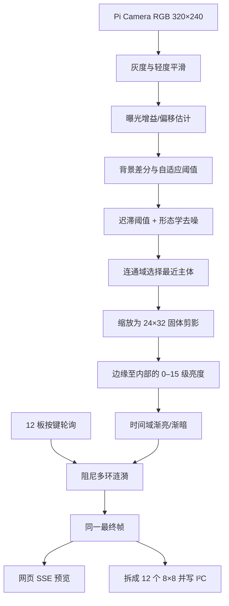

# 技术实现路径

## 1. 数据流

网页显示的不是另一套美化数据，而是 `hardware.send()` 合成涟漪后的同一 24×32 帧，因此可用于定位板块顺序、方向和亮度差异。

## 2. 相机与背景模型

Pi Camera 首先让自动曝光/白平衡稳定，然后尽力锁定曝光时间、模拟增益和色彩增益，避免静止场景因 AE/AWB 漂移而被误判为前景。

处理器建立空场背景。当前帧会先估算相对于背景的乘法增益和整体亮度偏移，再做差分，这能过滤灯光整体变亮、变暗造成的大面积假轮廓。启动后的 `calibration_seconds` 时间应保持画面为空；网页上的“重新校准”也应在空场时使用。

## 3. 剪影提取

核心步骤包括：

1. 依据背景差分噪声的中位绝对偏差计算自适应阈值，并限制阈值上浮范围。
2. 强阈值确定可靠前景，弱阈值只保留与可靠前景相连的区域，减少散点。
3. 通过形态学开/闭运算去除孤立噪声、连接主体内部断裂。
4. 对连通域按面积和画面位置评分，选择主要且更可能靠近摄像头的物体。
5. 填充主体轮廓后缩小到 24×32。
6. 小于最小面积的区域清零，剪影外严格为零。

单目普通相机没有真实深度数据，“最近”是用主体占画面面积、连通性和位置做的代理判断。如果场景必须区分重叠人物的真实前后距离，应改用深度相机或双目方案。

## 4. 抗残影

残影不能仅靠“8 秒且面积小于 30%”判断，因为静止的人和背景残留可能具有相似面积。本实现结合：

- 连通域与前一帧的 IoU；
- 连通域自身的运动比例；
- 静止累计分数；
- 背景的慢速学习；
- 判定为固定残留后的局部背景重建；
- 输出渐弱时间。

运动会阻止背景重建；稳定不动且与背景差异长期固定的区域会逐渐被吸收。这样仍存在语义限制：真实的人长时间完全静止，也可能最终被视为背景。可通过增大 `stationary_timeout_seconds` 或降低背景学习率换取更长保留。

## 5. 亮度层级与柔和变化

剪影掩模内使用距离变换：靠近边缘采用 `edge_min_brightness`，越向内部越接近最大值。`depth_gradient_pixels` 控制达到满亮所需的深度，`gamma` 控制曲线，最后量化为官方协议支持的 0–15 共 16 级。

时间方向采用独立的上升与下降常数：`rise_ms` 让出现时柔和渐亮，`fall_ms` 让离开时渐弱。`output_cutoff` 把极低尾巴清零，避免肉眼看到长期微弱残影。

## 6. 官方 OpenGrid I²C 协议

实现依据官方 Open-Grid-Controller 与 FREEPOET Keypad 项目：

| 用途 | 寄存器/命令 |
|---|---:|
| 协议版本 | `0x00`，期望 `0x02` |
| 板卡报告地址 | `0x01` |
| 按键/LED 数量低、高字节 | `0x02`, `0x03` |
| 显示缓冲区 | `0x13` |
| 批量写入压缩亮度 | `0x17` |
| 批量读取按键 | `0x21` |

每个亮度占 4 bit，范围 0–15，两个像素打包为一个字节。官方固件索引为 `keyIndex = x * 8 + y`，即列优先。为避开 Linux 常见的 32 字节单次写限制，64 个像素拆成 58 和 6 两段写入，再发送 `0x13` 显示。

连接新板时应用会读取协议版本、板卡报告地址和像素数量；一块板失败时仅把该板离线，并按 `reconnect_seconds` 重试，其他板继续工作。

## 7. 按键涟漪

程序按帧轮询部分板卡，默认每帧 4 块。在 12 FPS 下，每块约每 250 ms 被读取一次；400 kHz I²C 使 LED 写入、按键读取和相机处理仍能接近 12 FPS。

新按下事件经过板块布局与旋转映射到全局 24×32 坐标，生成带攻击时间和指数衰减包络的径向波。多个环由传播速度、波长与环宽共同形成：

- 暗背景上，正向波峰会产生独立发光涟漪；
- 剪影区域同时乘上正负波形，形成波峰变亮、波谷变暗的扰动；
- 相机采集和剪影处理不会暂停；
- 冷却时间抑制按键抖动，`max_active` 限制并发波数量。

## 8. 线程与故障降级

采集/处理/I²C 在后台线程持续运行，Flask 通过 Server-Sent Events 发布最新帧。浏览器慢不会阻塞灯板输出。如果程序启动时 I²C 不可用，会记录错误并降级为 `web-only`；运行中某一块板失联，会继续服务网页与其他板，并周期性重连。

## 9. 温控

独立的 root systemd 服务每 5 秒读取 CPU 温度。达到 75°C 时停止主程序，降到 65°C 后恢复。10°C 回差避免在阈值附近反复启停。温控服务与主程序分开，因此即使主程序被暂停，它仍能继续监测并自动恢复。
